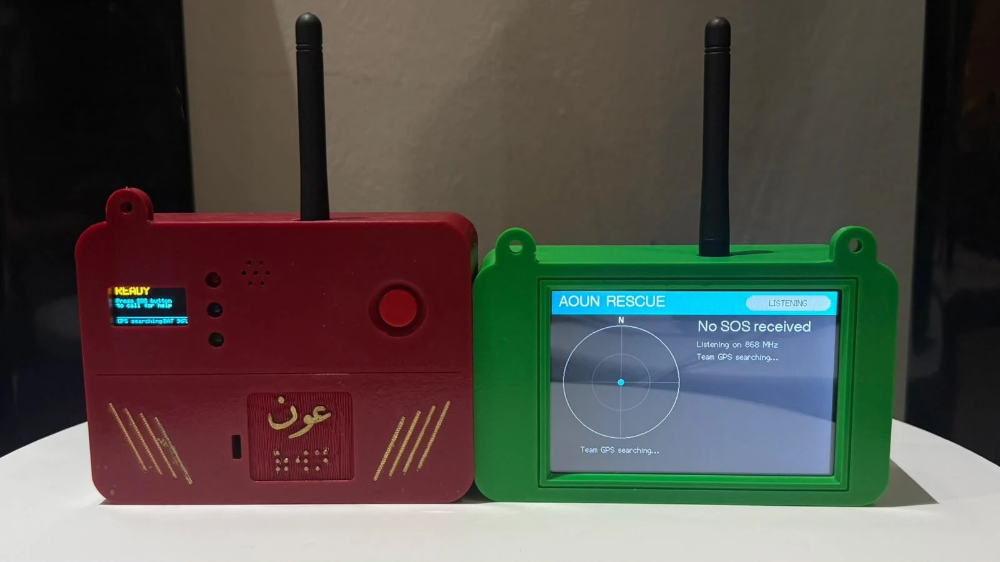
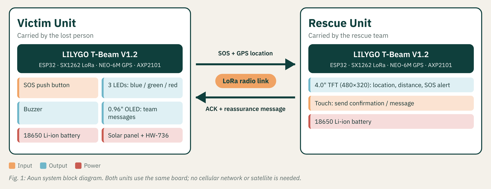
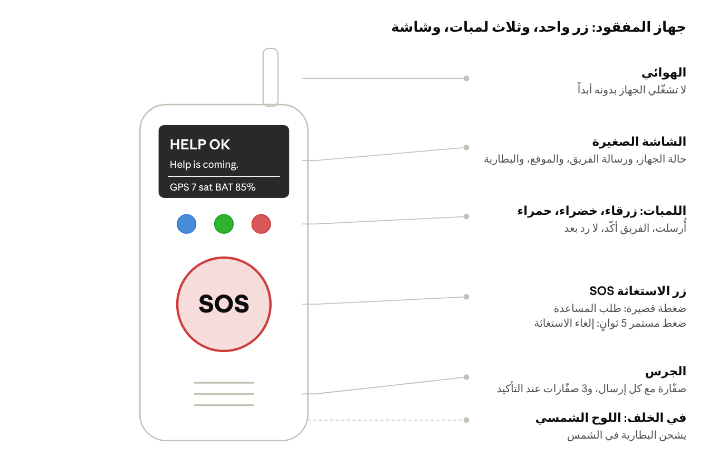
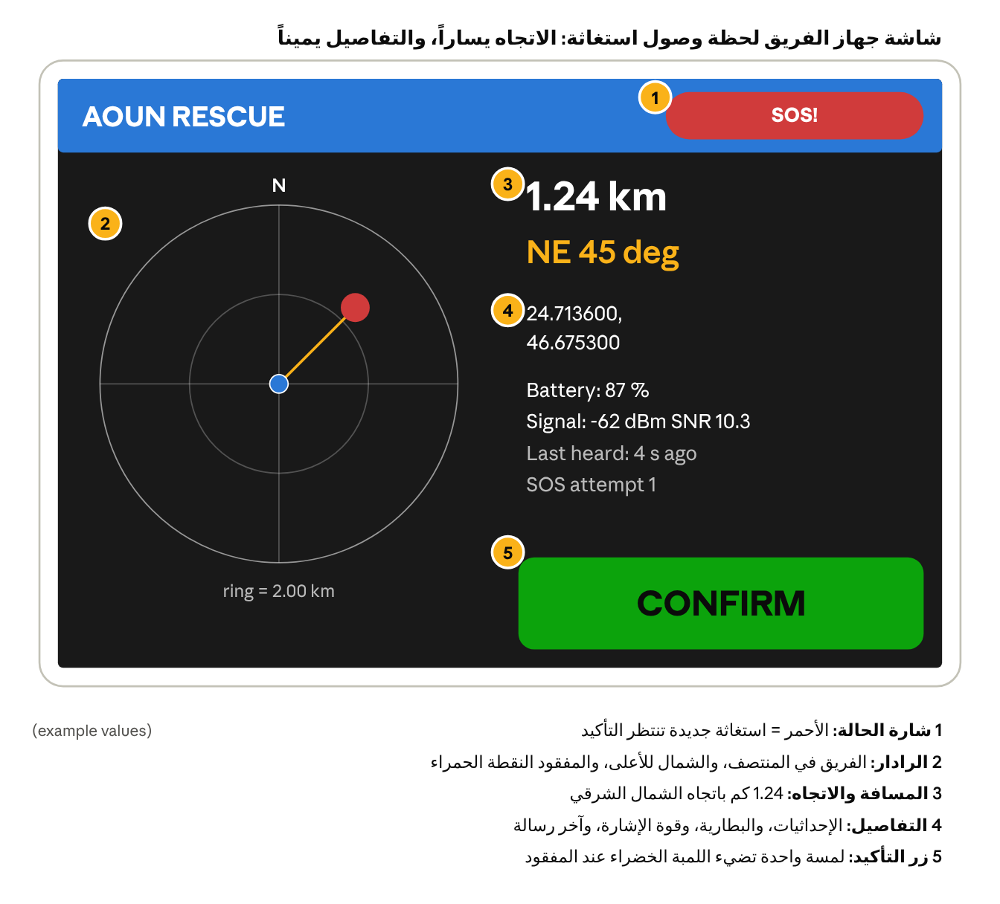
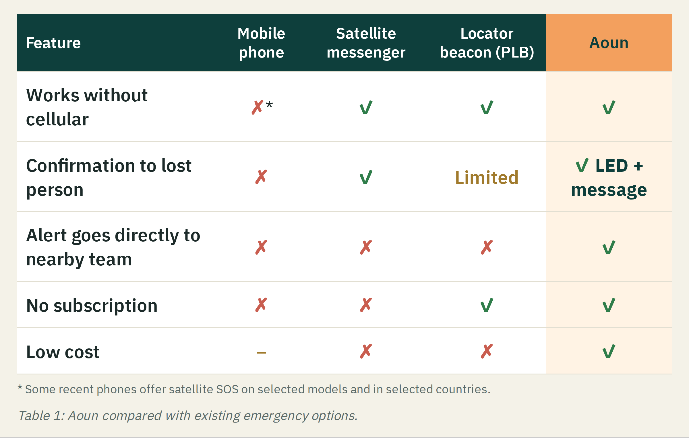

# Aoun (عون): Two-Way LoRa Distress & Tracking System

**A low-cost pair of devices that connects a lost person directly to a nearby rescue team, with no cellular network, internet, subscription or satellite.** One press of SOS sends the person's GPS location, and the rescue team sends back a confirmation, so the lost person knows that help is coming.

Graduation project · Technical Digital College for Girls, Riyadh · Programming & Web Development · 2026
Presented at the **Security & Innovation Fair (SAIF) 2026**: Smart Cities & IoT category.

[English](#english) · [العربية](#arabic)

> 📄 **Patent pending.** A patent application has been filed for Aoun. The source code, firmware and technical design details are confidential and are not published in this repository.

*The working prototype: victim unit (red) and rescue unit (green).*

---

## The Problem

- People lost in deserts, mountains and remote areas are often **far from cellular coverage**.
- Rescue teams then have to search **wide areas without an exact location**.
- A lost person who doesn't know their call was heard **may panic and move away** from the search area.

**Who it's for:** civil defence, border guards, volunteer rescue teams, desert trips and large gatherings such as Hajj.

## The Solution

Two devices that talk directly over long-range **LoRa** radio:

- **Victim unit:** one SOS button, three status LEDs, a buzzer, a small screen and a solar panel.
- **Rescue unit:** a touch screen that shows the **distance and direction** to the lost person, plus a **CONFIRM** button.

When the team confirms, the victim unit lights **green**, beeps and shows *"Help is coming. Stay where you are."*

| | |
|---|---|
|  |  |
| Victim unit: one button, three LEDs and a screen | Rescue unit screen: radar, distance, direction and CONFIRM *(example values)* |

## How It Works

1. The lost person presses **SOS**, and the location is sent encrypted (🔵 blue LED).
2. The rescue unit verifies the message and shows the distance and direction.
3. The team presses **CONFIRM**, and the lost person gets 🟢 a green LED, a beep and a reassurance message.
4. After confirmation, the victim unit keeps sending its location so the team can follow any movement.
5. If no confirmation arrives, the LED turns 🔴 **red** and the device keeps calling.
6. A long press cancels the SOS with a secure, verified cancel message.

## Why It's Different

**Two-way reassurance, not just an alarm.** Of the options compared, Aoun is the only one that tells the lost person, instantly and visibly, that the nearby team received the call, without any network, subscription or satellite.

## Security

Radio messages travel through the air, so every message is **encrypted and authenticated** (AES-128-GCM). Forged, modified, replayed or unknown-device messages are rejected.

## Results (prototype on two devices)

| Test | Result |
|---|---|
| Encrypted SOS received and verified by the rescue unit | ✅ |
| Encrypted confirmation received and verified by the victim unit | ✅ |
| SOS sent with a wrong key | Rejected 5 / 5 |
| SOS from an unregistered device | Rejected 3 / 3 |
| Indoor link (next room, upper floor, outdoor yard) | 100% delivery |

**Stage:** proof of concept. Field range testing (0.5 to 5 km) is planned next.

## Technologies

ESP32 (LILYGO T-Beam) · LoRa radio · GPS · Arduino C++ · AES-128-GCM encryption · SQLite (offline rescue records) · OLED and TFT touch displays · solar charging

## My Contribution (Hailah Alhejjei)

Core team member who contributed across the whole project, from the idea and system design through development and testing of the two devices.

## Team

| Name | Role |
|---|---|
| Dana Mohammed Al-Anazi | Team lead |
| Renad Mutab Al-Dosari | Team member |
| Jawaher Faisal Al-Sharif | Team member |
| **Hailah Abdulrahman Alhejjei** | Team member |
| Abrar Hassan Al-Qarni | Team member |

**Supervisor:** Ms. Dania Al-Mousa

---

## عون: نظام استغاثة وتتبع لاسلكي ثنائي الاتجاه

جهازان منخفضا التكلفة يربطان الشخص المفقود مباشرةً بفريق الإنقاذ القريب عبر موجات **LoRa**، **بدون شبكة جوال أو إنترنت أو اشتراك أو أقمار صناعية**. بضغطة زر SOS يُرسل المفقود موقعه، ويرد الفريق بتأكيد فيعرف المفقود أن المساعدة في الطريق.

مشروع التخرج · الكلية التقنية الرقمية للبنات، الرياض · تقنية البرمجة وتطوير الويب · 2026
شارك في **معرض الأمن والابتكار (SAIF) 2026**.

> 📄 **براءة اختراع:** تم التقديم على براءة اختراع لجهاز عون، ولذلك لا يتضمن هذا المستودع الأكواد أو التفاصيل التقنية للتصميم.

### طريقة العمل
المفقود يضغط SOS فيُرسل موقعه مشفّراً (لمبة زرقاء) ← جهاز الفريق يعرض المسافة والاتجاه ← الفريق يضغط CONFIRM ← لمبة خضراء وجرس ورسالة طمأنة عند المفقود ← تتبع مستمر للموقع. وإذا لم يصل رد تضيء اللمبة الحمراء ويستمر النداء.

### ما يميّزه
طمأنة ثنائية الاتجاه وليس مجرد إنذار، وتصل الاستغاثة مباشرةً للفريق القريب، مع تشفير كامل للرسائل.

### مساهمتي (هيلة الحجي)
عضوة أساسية في الفريق، ساهمت في جميع مراحل المشروع: من الفكرة وتصميم النظام إلى تطوير الجهازين واختبارهما.

### الفريق
دانا العنزي (قائدة الفريق) · ريناد الدوسري · جواهر الشريف · هيلة الحجي · أبرار القرني
**المشرفة:** أ. دانية الموسى

